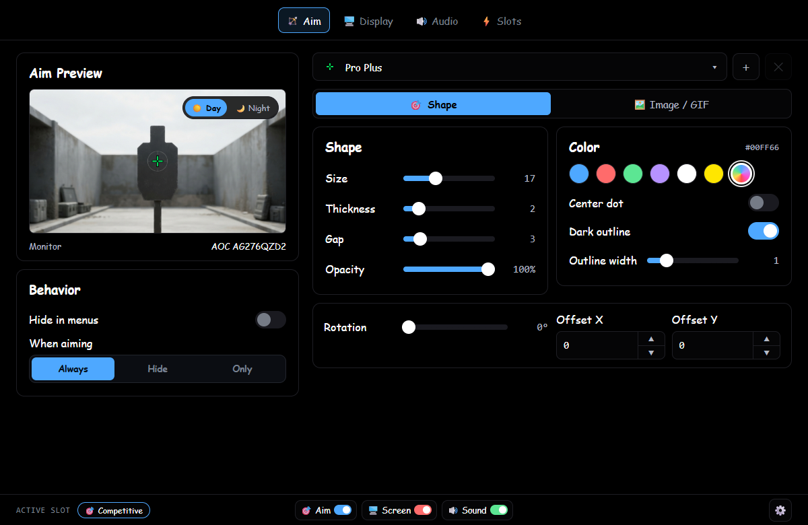
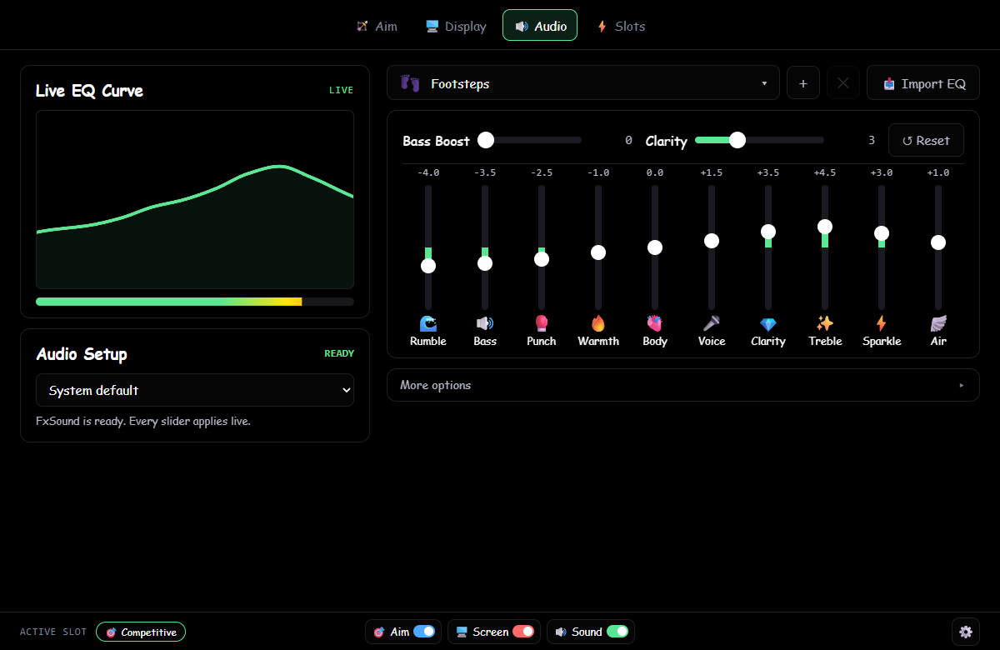
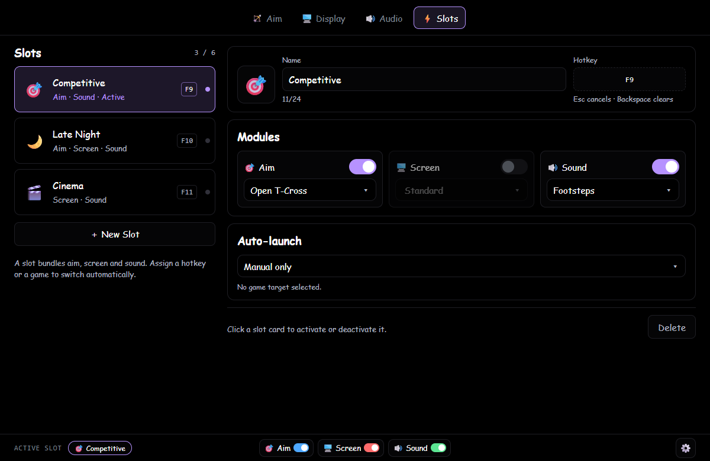

# 🏹 Crosshair+

A lightweight, portable Windows 10/11 gaming utility for **custom crosshairs**, **display calibration**, and **system-wide sound EQ**—all controlled from one OLED True Black interface with instant hotkeys and per-game auto-switching.

| 🎯 Aim | 🖥️ Display |
| :---: | :---: |
|  |  |

| 🔊 Audio | ⚡ Slots |
| :---: | :---: |
|  |  |

---

## ✨ What It Does

* **🎯 Aim (Crosshair Overlay)**
  * 7 built-in crosshair styles (*Plus*, *Dot*, *Circle*, *Circle + Dot*, *Triangle*, *Peak*, *T-Sight*) with size, thickness, gap, rotation, center dot, dark outline, opacity, and custom color picker.
  * Import your own custom **PNG, JPG, WebP, SVG, BMP, ICO, or animated GIF/WebP** crosshairs (with scale, rotation, invert, solid-color silhouette mode, and playback speed).
  * Smart visibility modes (**Always**, **Hide on Aim**, **Only on Aim**) plus optional hiding when Windows menus/cursors are open.
* **🖥️ Display (Screen Calibration)**
  * Adjust **Brightness**, **Contrast**, **Gamma**, **Warmth**, and **R/G/B** live with a real-time Day/Night preview.
  * Includes a 1-click **🌙 Blue Light Filter**, **Hold to Compare** (temporarily peek at your stock screen), smart panel tuning (*LED, OLED, IPS, VA, MiniLED, TN* with automatic panel detection), and DDC/CI / laptop backlight support where available.
  * Automatically restores your original Windows display colors when turned off, on exit, or on panic reset.
* **🔊 Audio (FxSound Integration)**
  * Simple **Bass** and **Treble** controls plus a full **10-band EQ**, live curve & volume meter, echo/clarity effects, and clip protection.
  * Import presets from **GraphicEQ, Equalizer APO, or AutoEq** (file or paste).
  * Automatically manages its own **Crosshair+** FxSound preset and backs up your original FxSound setup so your existing presets stay untouched.
* **⚡ Slots & Auto-Switch**
  * Bundle **Aim + Display + Sound** presets into up to **6 quick Slots** with custom emojis, hotkeys, and a single-key **Cycle Slots** shortcut.
  * Link any Slot to an open app or scanned Steam / Epic / Xbox game so your setup switches automatically when you launch the game and reverts when you close it.
* **🖤 Portable & Clean**
  * Runs from a single standalone `.exe`—drop it anywhere (like your Desktop) with no installer required.
  * Includes a themed OLED system tray menu, optional in-game hotkey toast notifications, and **`.zip` Backup & Restore** for all presets, slots, and imported crosshairs.

---

## 🚀 Quick Start

1. Download **`CrosshairPlus.exe`** from the **[Releases](../../releases)** page and run it anywhere.
   * *Note:* Because the `.exe` is unsigned, Windows SmartScreen may pop up on first launch—click **More info → Run anyway** (or build it yourself below).
2. *(Optional for Audio)* Sound EQ uses **[FxSound](https://www.fxsound.com/)** (`v1.2.11+`). If it isn't installed or needs updating, Crosshair+ will prompt you with a 1-click setup inside the **Audio** tab.

> **Game Compatibility Tips:**
> * **Use Borderless Windowed mode in games:** Crosshair+ uses a safe external overlay (zero game injection). Legacy *Exclusive Fullscreen* bypasses Windows desktop overlays, so switch games to *Borderless Windowed* if the crosshair doesn't appear.
> * **Games running as Administrator:** If a game or launcher forces Administrator privileges, run Crosshair+ as Administrator as well so overlays and global hotkeys can reach it.

---

## ⌨️ Default Hotkeys

| Key | Action |
| :--- | :--- |
| **`F8`** | Toggle Crosshair overlay on/off *(customizable in Settings)* |
| **`F9` – `F11`** | Toggle the first 3 Slots *(customizable per Slot)* |
| **`Ctrl + Shift + End`** | Reset crosshair rotation and X/Y offsets |
| **`Esc`** | Cancel hotkey recording or close popups |

*(You can also bind hotkeys in **Settings** for Display, Sound, **Cycle Slots**, and a **Restore display** panic shortcut.)*

---

## 🛠️ Quick Troubleshooting

* **Audio stops or plays on the wrong speakers (or after waking a Bluetooth/USB headset):** Wake/reconnect your headset and click **Settings → Maintenance → Refresh Audio**.
* **FxSound won't respond or needs a fresh install:** Click **Settings → Maintenance → Reinstall FxSound** (your settings and presets are backed up and restored automatically).
* **Crosshair isn't showing in a game:** Set the game's display mode to **Borderless Windowed**, and check whether the game is running as Administrator.

---

## 💻 Build From Source

Requires Windows 10/11 (x64), [Rust (MSVC)](https://www.rust-lang.org/tools/install), and Visual Studio Build Tools with **Desktop development with C++**.

```bat
BUILD.BAT build    :: Build standalone CrosshairPlus.exe
BUILD.BAT test     :: Run unit tests
BUILD.BAT run      :: Build and launch
```

*Settings, custom presets, slots, and backups are stored cleanly in `%APPDATA%\CrosshairPlus`.*

---

## 📄 License

[MIT](LICENSE)