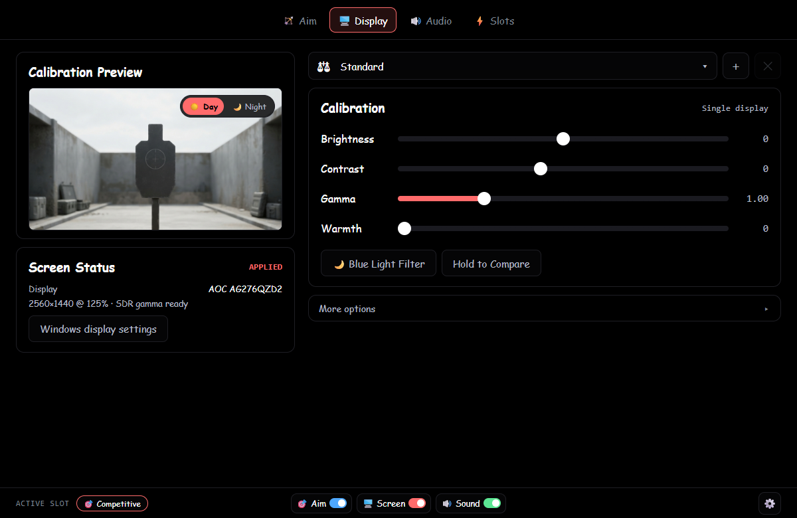

# Crosshair+

A portable Windows 10/11 app that overlays a customizable crosshair, calibrates your display, and controls the FxSound equalizer — all from one true-black interface.





## Features

**Aim** — a hardware-rendered overlay with seven vector presets (Plus, Dot, Circle, Circle + Dot, Triangle, Peak, T-Sight), rotation, centre dot, outline, opacity, colour picker and per-monitor targeting. Import PNG, JPG, WebP, GIF, SVG, BMP or ICO; animated GIF and WebP share one playback and speed control. Images can be scaled, rotated, inverted and recoloured. Aim visibility has three modes — **Always**, **Hide on Aim** and **Only on Aim** — and the crosshair can also hide itself while Windows menus are open.

**Display** — brightness, contrast, gamma, warmth and RGB calibration through the Windows gamma ramp, with LED/OLED/IPS/VA/MiniLED/TN response curves and monotonic LUT guarantees. Panel types are detected, HDR, Advanced Colour and Night Light are flagged instead of fought, and DDC/CI (or WMI laptop) backlight is supported where the monitor offers it. **🌙 Blue Light Filter** adds a warm tint without changing brightness, contrast or gamma, and **Hold to Compare** temporarily bypasses the calibration while held. Ramps are restored on disable, exit, logoff, sleep and panic.

**Audio** — a live WASAPI meter and EQ curve, ten faders with bass, clarity, ambience, surround, dynamic boost, master gain, levelling, balance, filter Q and clip guard. Import GraphicEQ, Equalizer APO or AutoEq profiles; an imported profile stays a separate base layer that your faders offset, and "Apply imported curve to sliders" can fold it into the ten bands when you want a simple setup. FxSound is driven through its CLI for live audio. Crosshair+ creates and selects its own **Crosshair+** preset, so applying a curve never rewrites your presets; it also keeps a one-time original backup and restores your previous preset on exit. See [FxSound safeguards](#fxsound-safeguards) for the exact files and conflict rules. **Reinstall FxSound** uninstalls and reinstalls it with a visible step-by-step progress; its fresh snapshot is separate from the original backup, which is never replaced.

**Slots** — up to six named slots bundling aim, display and sound. Each can have a hotkey and a game: **Installed games** scans Steam, Epic and Xbox folders so a game can be picked from a list instead of hunting for its `.exe`, and running apps appear automatically. The last scan is cached, so the picker opens instantly on later launches while a fresh scan runs in the background; a background scan that finds nothing keeps the cached list, and **Rescan** clears it. Crosshair+ switches to the slot when the game starts and reverts when it exits. The assignable **Cycle Slots** hotkey walks the slot list, then turns slots off.

**Interface** — 1200×780 WebView2 shell (1040×680 minimum) on a private protocol, pure-black DWM caption, tray menu with a **Slots** submenu, fixed-colour module switches, an HSV colour popover, in-app confirmation dialogs for destructive actions, and one atomic JSON config with automatic backups. Successful hotkey and slot changes can show a transient **in-game notification pill**; it can be disabled in Settings.

## FxSound safeguards

Crosshair+ treats your FxSound presets as user data. These rules run only in a live app session; the verification harnesses do not create, select or modify FxSound presets.


- **One-time original backup.** The first managed change copies the **entire** `%APPDATA%\FxSound` data folder to `%APPDATA%\CrosshairPlus\fxsound-backup`. The copy is only made when that folder is absent: an existing backup is never replaced, merged or deleted. Setup uses the same no-overwrite rule. Reinstalls use a separate snapshot (below), so the original backup stays original.
- **Crosshair+-owned managed preset.** Crosshair+ writes `%APPDATA%\FxSound\Presets\Crosshair+.fac` and selects that preset before sending any EQ or effect change. The ownership target is deliberately the stable file in `Presets`, **not** `AutoSave\Crosshair+.fac`: FxSound rewrites the `AutoSave` copy whenever EQ sliders move, so it cannot identify the app's preset. Only `Presets\Crosshair+.fac` is tracked.
- **Ownership marker and conflict handling.** `%APPDATA%\CrosshairPlus\fxsound-preset.json` records the managed preset name, its absolute file path and a fingerprint of the file bytes. If `Presets\Crosshair+.fac` exists but the marker is missing or its fingerprint no longer matches, Crosshair+ refuses to overwrite it and asks you to rename or remove the existing preset. The same refusal applies if FxSound lists a `Crosshair+` preset while the owned file is missing. Crosshair+ never silently adopts or deletes a user-created preset.
- **One restart when the preset is not listed.** After ensuring the preset is present (newly created or already owned), if FxSound is running and `Crosshair+` does not appear in `%APPDATA%\FxSound\status.json`, Crosshair+ stops FxSound and starts it once with `--run_minimized`. It rechecks `status.json`; if the preset still does not appear, it reports the failure instead of applying to an unknown preset.
- **Sound-off path.** When Sound is off, the only settings update Crosshair+ sends is exactly `--power=0 --run_minimized`. No band, effect, output or preset command is sent, so turning Sound off cannot rewrite your selected preset. (A cold start still uses FxSound's normal startup arguments, but no curve values.) Saving slider values still updates Crosshair+'s own JSON; the next enable selects the managed preset and applies them.
- **Exit and crash restoration.** A live session snapshots FxSound's power state and selected preset before applying anything. Clean exit restores both when FxSound is available; failures are logged. If the process crashes, `%APPDATA%\CrosshairPlus\safety-recovery.json` is applied on the next live launch. To select the original preset while FxSound was off, Crosshair+ briefly turns processing on, selects it, and returns power to its original state.
- **Reinstall isolation.** Reinstall writes a unique `%APPDATA%\CrosshairPlus\fxsound-reinstall-backup-<timestamp>` folder (a numeric suffix is added only if that millisecond is already used), restores from that snapshot, and leaves `fxsound-backup` untouched.
- **Unstick protection.** The manual **Unstick FxSound** action makes the same one-time backup, ensures the managed preset, and selects it before replaying the current settings when Sound is on. It never overwrites the original backup or a user-created preset.
- **Harness boundary.** `--capture`, `--stress`, `--verify-preset-delete` and `--interaction-test` never apply audio, restart FxSound, touch its process or settings, or create the managed preset and backup; they may read local status. `--verify-preset-delete` only creates and deletes presets in its disposable sandbox config. `--verify-fxsound` is genuinely read-only: it inspects the existing `status.json`, `Presets\Crosshair+.fac` and `fxsound-preset.json`, and compares the audio settings in the live `%APPDATA%\CrosshairPlus\config.json` against that status without launching FxSound, invoking `--status`, or writing live FxSound state. `--repair-fxsound` remains intentionally destructive.

## Fullscreen notes

The crosshair is a topmost layered window, so it draws over windowed and borderless-fullscreen games. True exclusive fullscreen bypasses desktop composition, and no layered overlay — Crosshair+ included — can appear inside it, so use borderless or windowed fullscreen when the crosshair does not show. Xbox Game Bar widgets are not supported.

Games launched as Administrator need Crosshair+ to run at the same privilege level; otherwise the overlay and hotkeys cannot reach the elevated game. If a launcher or anti-cheat starts the game elevated, start Crosshair+ as Administrator too.

## Troubleshooting

- **FxSound is silent or stuck on the wrong output:** open **Settings → Maintenance → Refresh Audio**. It stops and restarts FxSound, reconnects a physical playback device, and reapplies the current sound settings.
- **A Bluetooth or USB headset slept or was unplugged:** wake or reconnect it, then open **Settings → Maintenance → Refresh Audio**. It restarts FxSound on the current physical output and reapplies your saved sound settings; Crosshair+ itself does not need a restart.
- **FxSound needs a clean reinstall:** **Reinstall FxSound** backs up the FxSound settings and presets, uninstalls and reinstalls the app, then restores them.

## Requirements

- Windows 10 or 11, x64.
- [WebView2 Runtime](https://developer.microsoft.com/microsoft-edge/webview2/) (preinstalled on current Windows releases).
- Optional: FxSound **1.2.11 or newer** for live sound control. Older or missing installs are detected and offered Setup or Reinstall.

## Build from source

You need Rust stable (MSVC toolchain) and Visual Studio Build Tools with the **Desktop development with C++** workload. `BUILD.BAT` finds the MSVC environment through `vswhere`, so no PATH changes are required.

```bat
BUILD.BAT preflight   :: check toolchain, WebView2 and winget
BUILD.BAT build       :: regenerate embedded art, then build release
BUILD.BAT test        :: run the test suite
BUILD.BAT run         :: build and launch
```

The release build is `target\release\CrosshairPlus.exe`; the tested copy at the repo root is `CrosshairPlus.exe`. UI and image assets are embedded, so it runs alone. With a Developer Command Prompt open you can also use `cargo build --release --locked` and `cargo test --release --locked`.

## Run

Launch `CrosshairPlus.exe`. The executable is unsigned, so Windows SmartScreen may warn on first launch: choose **More info → Run anyway**, or build it locally with `BUILD.BAT build`. On first run it creates:

- `%APPDATA%\CrosshairPlus\config.json` — settings, presets and slots.
- `%APPDATA%\CrosshairPlus\crosshair.log` — rotating diagnostics.
- `%LOCALAPPDATA%\CrosshairPlus\WebView2` — the WebView2 profile.

When live sound is used it may also create:

- `%APPDATA%\CrosshairPlus\fxsound-backup` — the one-time original FxSound snapshot, never overwritten.
- `%APPDATA%\CrosshairPlus\fxsound-preset.json` — ownership marker for the managed preset.
- `%APPDATA%\CrosshairPlus\fxsound-reinstall-backup-<timestamp>` — a reinstall-only snapshot.
- `%APPDATA%\CrosshairPlus\safety-recovery.json` — crash-recovery power/preset snapshot, cleared on clean exit.
- `%APPDATA%\FxSound\Presets\Crosshair+.fac` — the managed FxSound preset.

**Backup & restore** (Settings → Maintenance) writes your custom presets, slots, imported images and EQ profile to one `.zip` and restores them after a summary and confirmation, keeping a safety copy so the restore can be undone. **Factory reset** restores the OS display ramps and the FxSound power state, then wipes settings, presets and imported images; the log and FxSound safety backup are kept.

## Hotkeys

| Key | Action |
| --- | --- |
| `F8` | Toggle the aim overlay (default; assignable) |
| `Ctrl+Shift+End` | Reset rotation and offsets |
| `F9`–`F11` | Activate the first three slots |
| `Esc` | Cancel hotkey capture, close a dialog or menu |

Aim, Display, Sound and **Cycle Slots** can each get their own hotkey in Settings, plus a **Restore display** panic hotkey that returns the screen to normal and switches Display off without opening the window; slots can be assigned in the slot editor. Duplicate, malformed and Windows-reserved shortcuts are rejected visibly.

## Developer commands

- `CrosshairPlus.exe --capture` — writes the four reference screenshots, runs the built-in UI self-test, and exits without touching the saved configuration or applying FxSound changes.
- `CrosshairPlus.exe --interaction-test` — sandboxed interaction harness with OS/FxSound/registry side effects disabled (requires `CROSSHAIRPLUS_SANDBOX_DIR`).
- `CrosshairPlus.exe --verify-preset-delete` — sandboxed custom-preset deletion check; it uses the normal config paths inside `CROSSHAIRPLUS_SANDBOX_DIR` and does not touch FxSound.
- `CrosshairPlus.exe --verify-fxsound` — read-only inspection of existing state: it reads `status.json`, the managed preset file and the ownership marker, and compares them with the audio settings in the live `%APPDATA%\CrosshairPlus\config.json`, without launching FxSound or invoking `--status`, and never writes live FxSound state (requires `CROSSHAIRPLUS_SANDBOX_DIR` for its result files).
- `CrosshairPlus.exe --verify-unstick` — sandboxed integration harness for the manual Unstick sequence. It redirects FxSound's data tree and executable to a stub CLI (this executable re-entered with `--fxsound-stub`), then exercises the real power-off, stop, physical-output choice, start, managed-preset creation, power-on, preset selection, apply and verification path with Sound on. A second Sound-off scenario proves the recovery sends only the power-off call and leaves the existing preset and output untouched. It also uses the same executable's internal parent mode to start a real stub, waits until it is running, closes that parent's stdin and verifies the stub exits and clears its pid stamp. It uses its own disposable sandbox unless `CROSSHAIRPLUS_SANDBOX_DIR` is set, and never touches the live FxSound process, audio settings, `status.json` or `%APPDATA%\FxSound` tree.
- `CrosshairPlus.exe --verify-games-cache` — sandboxed headless proof of the installed-games cache: runs a real scan, writes `games.json` through the normal save path, reads it back and reports counts, bytes and timing in `games-cache-result.json` (requires `CROSSHAIRPLUS_SANDBOX_DIR`, so it never touches your real cache).
- `CrosshairPlus.exe --repair-fxsound` — runs the real Settings → Reinstall FxSound sequence headlessly and writes `fx-repair-result.json` (stage timings, versions, settings round trip) next to the log. It uses a unique reinstall snapshot and preserves the one-time backup. **Destructive:** it uninstalls and reinstalls FxSound, so sound drops for the length of the reinstall.

While the crosshair is running, `crosshair.log` gains an `overlay: cost …` line every 30 s: paints in the window, repaint rate, average and peak paint time, and the overlay thread's and the process's CPU as a percentage of one core. Windows where Aim was off report `visible=false paints=0`, so the crosshair's own cost can be compared with the app idle.

`cargo test` covers DSP and headroom guards, EQ import and flattening, config validation and cleanup, animated WebP decoding, slot snapshot restore, hotkey policy, FxSound managed-preset ownership and one-time backups, backup/restore safety, and the Steam/Epic/Xbox install parsing used by game discovery.

## License

MIT. See [LICENSE](LICENSE).
